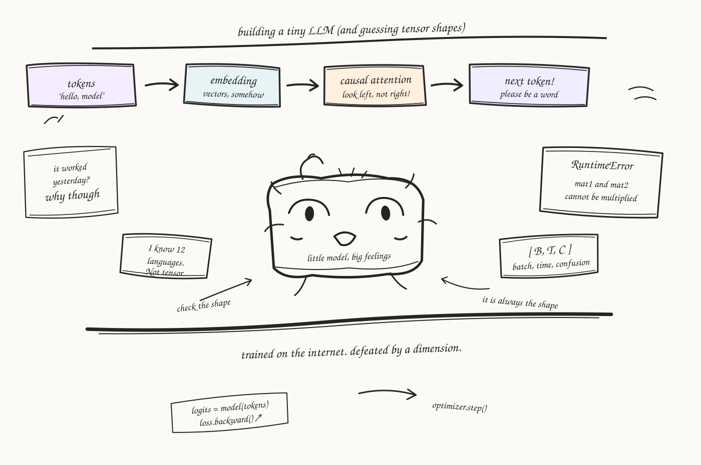

A collection of notebooks and small Python experiments as I learn how language models work in PyTorch. I’m exploring tokenization, embeddings, and attention, and trying to understand how the pieces fit together. It’s a work in progress.
